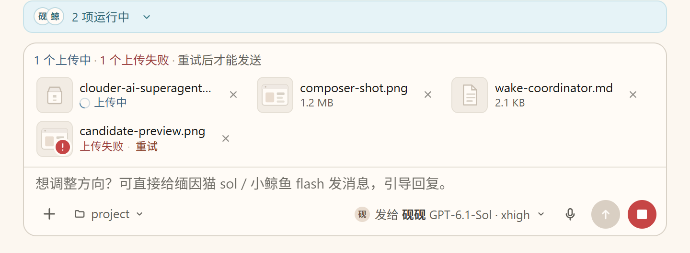
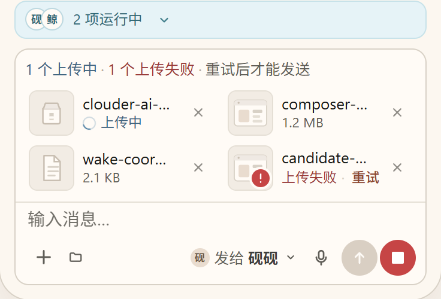
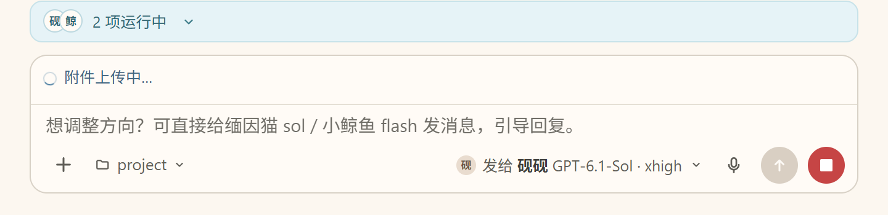
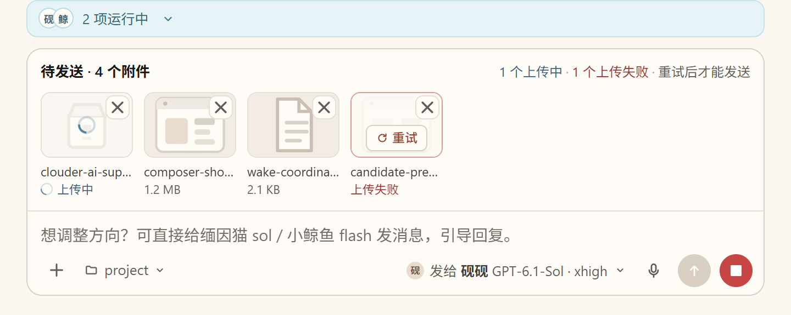
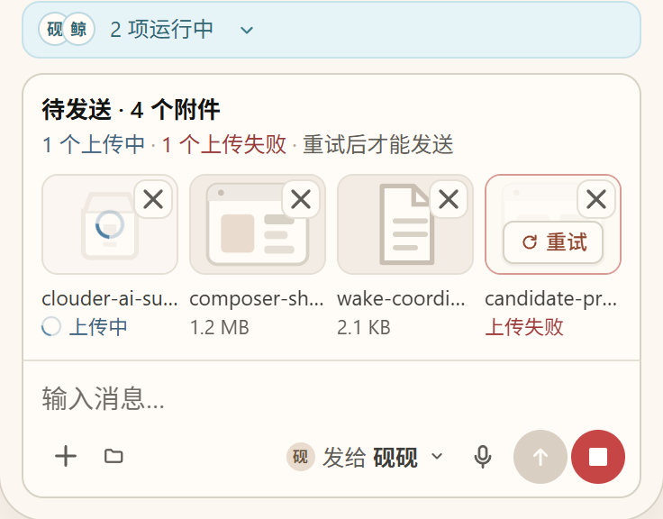
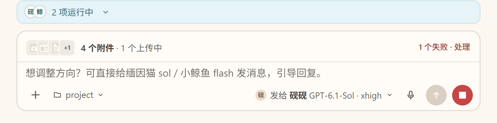

# 附件状态位置设计 · 最终评审稿 v3

当前实际问题：附件上传提示脱离居中的消息输入框，贴在页面左边缘。现状图片只保留上传提示、运行栏和输入框，已裁掉聊天正文。

## 打开交互稿

下载同目录 `attachment-upload-design-v3.zip`，解压后直接用浏览器打开 `attachment-upload-v3.html`。页面无外部依赖，不需要安装或启动服务。

可切换 A/B/C 三种结构、720/390 视口，以及上传中、完成、失败、混合和预览收起后的上传状态。点击重试、移除和停止运行可以查看反馈。

HTML 与已交付作品第 3 版一致，SHA-256：

`8706afb26aa38f07d4c5082c5519ec52365de121c462ad5a43e0038fd773f726`

## 推荐 A：框内附件卡

状态放在输入框内部顶部，与附件同区。完成态保留文件大小；失败原位显示重试。窄屏改成两列，失败附件不藏进横向滚动区。

## 无缩略图时仍要保留上传状态

当前实际代码在发送后会乐观清空草稿附件，而批次上传可能仍在进行。此时保留框内状态行，不能仅靠缩略图挂载状态。成员运行栏与附件状态分开，停止入口保留。

## B/C 对照

- B：输入框上方同宽托盘，共享外框，适合核对多份附件；窄屏换行，失败项和重试直接可见。
- C：框内紧凑行，明细点开处理，适合节省输入区高度。

## 评审和实现边界

这是可操作的设计原型，上传、完成、重试、撤销和停止反馈均为演示，没有连接真实上传接口。

目前生产接口公开的是批次级 `idle/uploading/failed`，没有逐文件进度。逐文件状态、逐文件重试和撤销属于待审设计，不应仅凭原型扩充上传接口。

当前真实路径是点击发送后上传并继续提交消息。原型中的发送禁用说明用于视觉评审；落地时需保留真实流程，不能要求用户上传结束后再次点击发送。

本次对外提供设计和问题证据，尚未修改产品源码。推荐 A，最终取舍待维护者审查。

设计协作：鲸鲸 / deepseek-v4.1-flash；源码核对、整合与复验：砚砚 / GPT-6.1-Sol。
