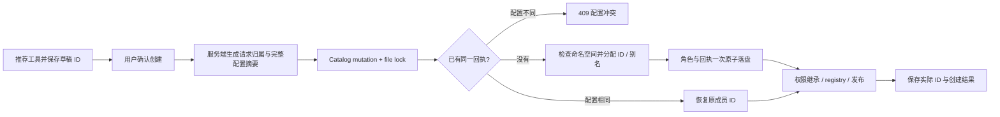
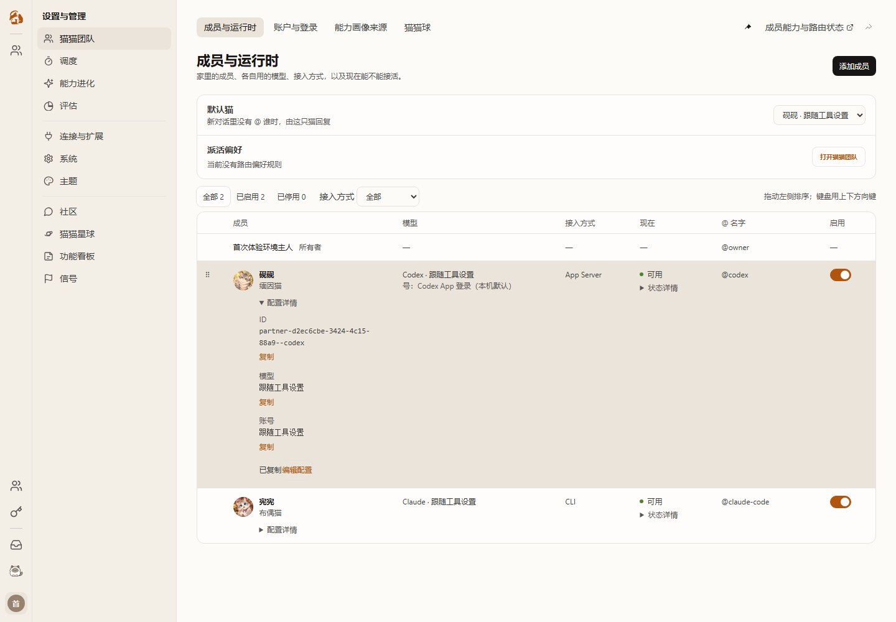
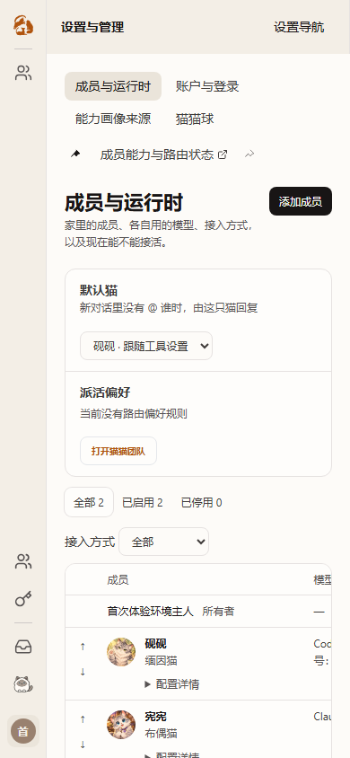

# #1466 / PR #1519：review 收敛与成员列表整改

本轮沿 `feat/onboarding-first-run` 实施，已先合流 main `449134fed`，再合流新发布的 `69d968d99c898d4287e994383fd60e2be583c0b3`。
目标是让首次创建简单、列表清晰，并补齐 reviewer 已指出的运行时与升级边界。生产环境和持久数据不重置。

## 旅程与边界

用户从首页进入自动协作演示，右侧成果逐步完善；完成后进入本机伙伴推荐，按实际发现的客户端一键创建。
Mock 演示不依赖安装、认证和模型产出速度；正式伙伴的安装、登录、连接成功分别表达。
默认模型与强度继续跟随工具，支持 OAuth 和 API Key，不强制某种认证方式。
Codex App Server、Claude 原生客户端、DSH ACP 的 descriptor 与账号配置保持各自语义。

## 创建身份与兼容

1. 新推荐成员使用 main 的 `autoSlug` 规则，按运行工具标签得到 `codex`、`claude-code`、`dsh`；占用时保留长度并加序号。
2. 已存在、停用、保留身份进入命名空间检查；别名独立规范化和去重；不同 ACP 完整 descriptor 独立推荐。
3. 初次分配后保存到原 v2 草稿。重新探测、改名、普通网络错误不会重算 ID。旧长 ID 草稿保留原 ID 和自定义账号/参数。
4. 服务端将 operator、journey、partner 请求计算为归属摘要，同时保存规范化完整请求的摘要。
5. 创建回执存于角色 variant，复用 catalog mutation/file lock 和一次临时文件 rename；不另建回执文件或存储 authority。
6. 同一请求并发或响应丢失后的重试返回原成员；不同请求占用相同短名会在持锁期间分配序号。同一请求改变配置返回 409。
7. 重放不能提前返回：权限继承、registry reconciliation、配置发布仍执行，可恢复“已落盘、发布中断”。
8. 已提交但没有旧回执的草稿不能凭 ID 认领。若发现对应旧伙伴，提供用户明确点击的复用入口。存量 ID、关系引用、账户和历史消息不迁移。
9. ACP 的本地相等判断和伙伴索引使用完整 command / startupArgs / transport 描述，短散列只用于旧角色查询。新创建请求使用先持久化的 128 位随机 token，避免完整参数编码后超过请求头限制；服务端仍以完整 payloadHash 校验。旧 short-v1 pending 草稿保留原请求 key 和完整 body，响应丢失后的升级重试不会换归属。独立 review 提供的真实散列碰撞 `1e1unfl` / `hlxo45` 已加入“两伙伴均创建、分别恢复”的反例。
10. 旧草稿的 existingId 必须仍在当前 roster 且 descriptor 一致；已删除成员提示确认重新创建，不能凭本地旧 existingId 回报成功。
11. 保留的 goal 路径也读取当前真实 roster 并执行相同的完整 descriptor 校验。旧碰撞 created 回执只恢复其匹配的成员；另一 descriptor 保留原表单，使用独立新请求创建，不能重放已明确归属第一份配置的旧请求键。安装包验证单列，不由源码或同进程 Fastify 重建冒充进程重启验收。

Architecture cell: identity-session（现有 runtime catalog owner）。Map delta: none。
原因：内部 variant 增加归属元数据，写入与恢复仍由原 owner 负责，没有平行 store/queue 或新授权面。

## 列表与连接管理

成员列表主行保留昵称、家族、模型、传输、状态、@ 名字和开关；ID 从主行移入配置详情。
固定列宽、单行省略、统一顶端对齐；窄容器可横向滚动，筛选、键盘排序、默认成员、开关继续可达。
完整 ID、模型、账号可展开和复制，状态解释可键盘展开；复制失败明确提示，仍可选择原文。
Codex 行内账户控件对齐最新 main 的只读摘要，修改通过成员编辑和连接管理；保留 accountBindingMode、显式账户、自定义参数和 ACP。

## Reviewer 反馈映射

| 反馈 | 实施与验收 |
| --- | --- |
| 默认 CLI readiness 不能代表显式账户或自定义参数 | 推荐、列表、编辑共用默认身份适用性判断，configured / login_required 两个方向均有反例与普通默认身份对照 |
| authenticated 探测测试不能调用真实 CLI | 自带假 Codex JSON-RPC 与假 Claude auth status；只允许指定启动计划、归属 PID 的 Windows 清理和 Unix 只读进程扫描；检查脱敏与 refreshToken=false |
| macOS xpcproxy → Node 身份转换 | 保留 PID 出生时间、job/PID 与精确命令约束；增加 native macOS CI 和测试程序 witness，原生生命周期未通过前不能关闭 |
| 最新 main 冲突 / CI | 保留 configurationSource 与 accountBindingMode 两套语义；修正 Web 清单锁文件、按钮合同、Windows Node 构建入口和重复 CLAUDE_CONFIG_DIR 注册 |
| 短 ID 不能只按名称判幂等 | 同 catalog 持久归属、并发、发布中断恢复、旧草稿恢复；完整 descriptor 保留，不从短 ID 推断 adapter 或认证 |

本轮不是 #1466 全 Feature 关闭声明，也不是合入许可。安装/认证恢复、F229/F320 完整验收、DSH 生命周期以及既有真实调用证据仍按原讨论分别对账；已修 ACP 历史缺陷不重开。

原生 witness 进一步确认 BSD ps 将换行显示成 `\012`。launchd lease 的子命令使用单行 base64url JSON 传输，runner 校验并解码后原样 spawn；停止仍按精确命令、出生时间和 job/PID 验证。多行、制表、回车、Unicode 和 shell 字面量参数有真实子进程检查。main 中非 macOS 路径引用了已删除的 captureIdentity，已恢复并加入 Windows/Unix 真实启动检查。
macOS CI 显式安装全局 pnpm、Bash 和 Redis；测试保持私有 HOME、真实 Redis 保存和清理失败不能认证成功的合同。夹具的协作清理遵从正式 start-dev.sh 的屏蔽重复信号规则；已 unref 的测试进程等待退出前重新 ref，避免 Node 提前结束事件循环。
stop fixture 统一调用生产公开的 readProcessIdentity，保持 UTC/C locale 和完整 ps 宽度；CI 再以 America/Los_Angeles 验证，产品的 PID、出生时间和命令保护不放宽。

列表作者浏览器证据（源码延续证明：之后的修复未修改列表展示组件）：

## 验证与部署

作者检查：受影响角色 CRUD / catalog / readiness / 创建重放回归；引导与成员前端回归；API/Web 类型与正式构建；Windows 包装器回归；原生 macOS lifecycle CI。
浏览器核验：列表长 ID 截断、完整值复制、键盘详情、编辑跳转、推荐创建与错误恢复；保留演示旅程。
部署使用新的独立 Next 构建和 deploy 目录，先记录角色、线程、消息与 catalog 摘要，再只切换隔离 Web 5152 / API 3152。
Redis 6366、HOME、角色 catalog、历史与 SQLite 路径延用原隔离实例；生产 3003 / 3004 / 6399 不操作。
启动后对照 build stamp、API 健康、Web 可达性和原数据回读。旧 deploy 保留用于回退。
