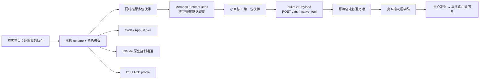

# #1466：配置本机伙伴，完成真实的小目标

## 本轮决策与范围

2026-10-12 用户明确修正了此前原型：

> 引导就不要演示了，直接引导用户配置自己的 client agent 伙伴，然后引导给一个小的目标进行完成。
> 本地有 claude、codex、dsh 三个我们都支持的 client，那么就可以三个都引入进来。
> 直接基于实际的项目来落地实施，然后用一个隔离的环境让我看看效果。

最新指令覆盖 #1466 / #1519 历史讨论中的“三猫示范”和独立 HTML 路线。其他已接受原则继续成立：探测后推荐、用户确认才创建、模型和强度独立跟随、保留现有连接、失败可恢复、不影响历史数据。

主线为 `feat/onboarding-first-run` / PR #1519。不恢复 #1453，不更新生产 runtime。本轮是既定分批顺序中的伙伴引导；一键安装、完整训练营和 PR 其他历史 review 项仍需各自验收，不能据此关闭整个 issue。

## 用户路径

1. 真实首页“配置我的伙伴”直接打开本机推荐清单。
2. Claude Code、Codex、DSH 均可同时加入；默认勾选发现的可配置工具，同一启动描述去重。已有原生成员可复用。
3. 默认只显示名字、工具、模型/强度跟随状态。“调整”折叠项复用新版成员设置组件，支持名字、昵称及真实模型目录。不重选认证方式、不重复填写 key。
4. 输入一个小目标（可用建议、可完全改写），选择第一位响应伙伴；其他已加入伙伴可在正常聊天中 @。
5. 点击保存后真实创建成员和普通对话，把目标放入正常输入框。用户确认发送，由自己的客户端返回结果。没有示范消息，不注入旧训练营流程。

“发现工具”“目录已读取”“伙伴已添加”“收到回复”“目标完成”是不同事实。向导不把安装或第一条消息发送成功标成任务完成；执行与结果展示沿用真实聊天。

## 技术与兼容

- 改用成员设置已有 `/api/cats/native-runtimes`，旧 `available-clients` 接口保持兼容，不再承担新向导发现。
- DSH 优先沿用已有 ACP 描述；空白项目支持 PATH 或 npm 缓存里的已安装程序及现有 `profiles/acp`。发现仅读元数据，不执行 npx、不安装 profile、不读取/返回凭据。
- 模型目录仍使用 Codex `model/list`、Claude SDK 模型列表和 DSH ACP 配置选项。目录失败时保留跟随工具，可以刷新。
- 原生保存不固定 accountRef，不把检测到的当前模型复制为角色覆盖。用户主动高级设置才产生模型/强度覆盖。
- 草稿隔离在 `cat-cafe:native-onboarding:v2:<session userId>`，保留选择、小目标及逐个保存的进度。不覆盖旧 v1 旅程和训练营状态。
- ACP 推荐 ID 由启动描述生成，避免创建后 runtimeId 改成 `acp:成员ID` 导致重复创建。成员使用稳定 catId 和原有 journey 幂等契约。
- `ensureOnboardingThread` 允许不带 bootcampState，继续使用 user + journey 的原子幂等身份。旧训练营调用行为不变。
- 输入框使用 `syncDraftToStorage`；正常导航、执行和历史消息链路复用。不迁移或清空生产数据。

## 状态验收

| 场景 | 处理 |
|---|---|
| 检测中 / 读取失败 | 显示进度/错误和重试，不提前提交 |
| 0 个 / 部分 / 多个工具 | 未发现项不默认勾选；至少选择一项才继续 |
| 登录未知 | 首次真实对话验证，不显示“调用通过” |
| 模型目录失败 | 保留跟随和已有偏好，提供刷新 |
| 部分保存失败 | 保留成功项，重试跳过，稳定 ID 防重复 |
| 返回 / 关闭 / 刷新 | 不自动创建，保留草稿 |
| 已有用户 | 不强制重新首启，已有训练营和历史路径保留 |
| 小屏 | 正文滚动、底部动作可达 |

## 实例与证据

代码目录：`G:/AIwork/clowder-ai/worktrees/feat-onboarding-first-run`。

隔离实例：`G:/AIwork/clowder-ai/artifacts/issue1466-native-onboarding-20261012`。

- Web `5126`、API `3126`、独立 Redis 进程 `6376`；辅助服务端口单独分配。
- 独立 HOME、CLI 配置副本、应用配置、SQLite、transcript、Redis 数据目录与 cookie 名。
- 只复用已安装程序/依赖。副本移除外部 hooks/MCP，原配置只读并用摘要核对。
- 空成员 catalog，角色模板来自项目；生产 `3003/3004/6399` 不重启、不切分支、不写入。

具体验证结果另附本轮验证记录。作者自测不替代独立 review。
