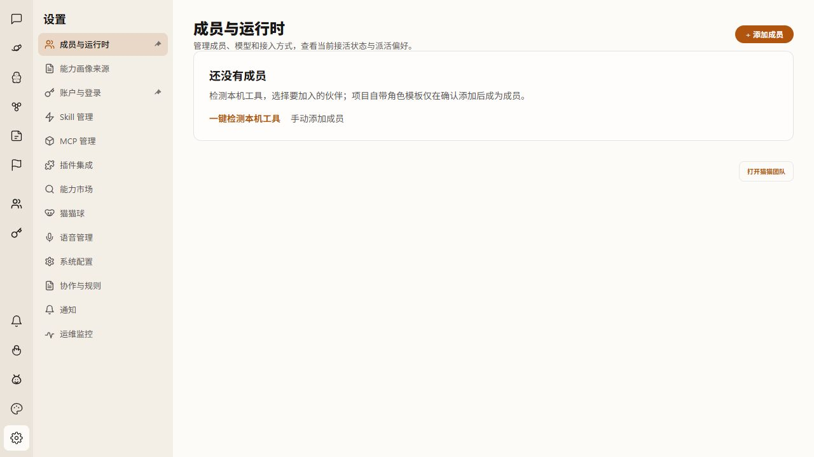

# #1651 空名单首启

来源：[#1651](https://github.com/zts212653/clowder-ai/issues/1651)；用户于 2026-10-21 明确将原 A+B 调整为「全新安装从零成员开始，检测后由用户选择并确认添加；已有安装保留成员」。不扩展默认品种。

## 用户体验与范围

- 全新安装只有所有者，无自动创建的猫猫。首页和成员空态提供一键检测及手动添加，角色模板保留为可选菜单。
- 检测只展示工具、登录证据和候选角色；勾选并确认后才创建成员，不因检测产生模型调用。
- 已登录不等于调用成功；缺少安装、需要登录和连接待验证沿用现有就绪状态。
- 首次引导由明确的安装初始化标记与个人持久化回执控制，关闭/完成后不反复弹出。旧安装不凭空名单或成员数量认定首启。
- 重启、读配置、模板升级均不能给新安装补入未选择的品种或变体。已有成员、修改和删除选择保留；旧安装保持现有兼容迁移。

## 契约与实施

Architecture cell: 成员 catalog / 首次引导 / 成员设置。
Map delta: none；继续使用 catalog 单一写入源和用户偏好回执。
Why: 移除历史 seed 绕过空态的行为，恢复检测后由用户确认的创建边界。

Canonical source: `cat-catalog-store.ts#bootstrapCatCatalog`、`cat-config-loader.ts#mergeTemplateWithCatalog`、`config-onboarding.ts`。
Consumer evidence: `rg -n 'bootstrapCatCatalog|pickSeedBreed|persistMissingTemplate|removeUnavailableTemplateVariants|useDemoAdmission' packages/api/src packages/web/src`。
Claim guard: 首启、三次重启、选择单个变体、删空、旧 catalog、个人回执 → `empty-first-run-catalog.test.js` 与 onboarding 回归；任何自动加入未选成员、误认旧安装或丢回执都应失败。

新 catalog 写入版本化 `memberInitialization: user_selected_v1`；只控制自动添加与引导资格，不迁移旧 catalog，也不新增角色来源猜测。普通 CRUD 持有并保留根元数据。回退代码仍可读取原 catalog；回退旧行为会恢复旧版补齐策略，因此应保留本 PR 代码直到维护者确认。

## 验证

先观察新回归在原实现的失败，再修改初始化、升级补齐与只读合并三处消费路径。API 使用实际 bootstrap/loader/HTTP route，Web 使用真实 hook/组件与既有检测创建测试。

格式化使用 `node node_modules/@biomejs/biome/bin/biome check <本次文件>`；API `tsc`、Web `tsc --noEmit`，运行受影响回归。浏览器使用独立 worktree 和测试数据验证首页空态、检测候选、无工具、取消与确认、刷新；不使用生产端口，不调用真实模型。

## 本轮作者验证

- API：`empty-first-run-catalog`、catalog store/loader 和 onboarding 偏好/回执/读取失败回归，共 172 项通过；API TypeScript 编译通过。
- Web：首次引导、检测创建、成员故障与默认成员并发、新对话和文案回归，共 31 个文件、199 项通过；`tsc --noEmit` 通过。新增 SSR → hydration 检查先复现空态切换导致的 hydration 错误，修复后通过。
- Biome 检查本次 20 个源码/测试文件，无错误；保留既有大文件复杂度等警告。`git diff --check` 通过。
- 在本 worktree 启动实际 API 和 Next 应用，独立端口 3198/5198，使用隔离 HOME 和内存存储，不连接 Redis。实际走过：首次空名单 → 关闭引导并刷新 → 检测候选 → 取消仍为空 → 再次检测并确认一位 → 刷新仍仅一位。检测确认前磁盘 catalog 仍为零成员，整个旅程无模型请求。
- 空成员页在 390px 窄屏无横向溢出；实际浏览器确认 hydration 修复后没有新增错误。成员空态见下图。

原生工具登录状态使用隔离的 `claude.cmd` 测试替身，因此以上只证明实际应用中的检测、确认与持久化旅程，不代表真实账号、模型调用、安装器首装或生产环境验收。已有安装的兼容保留通过 catalog/loader 回归覆盖；本次不部署生产环境。

独立审查结论随最终 PR 记录。验证日志、实例台账及测试数据保留于任务 artifacts；提交不包含 HOME、凭据、运行日志或测试临时目录。
