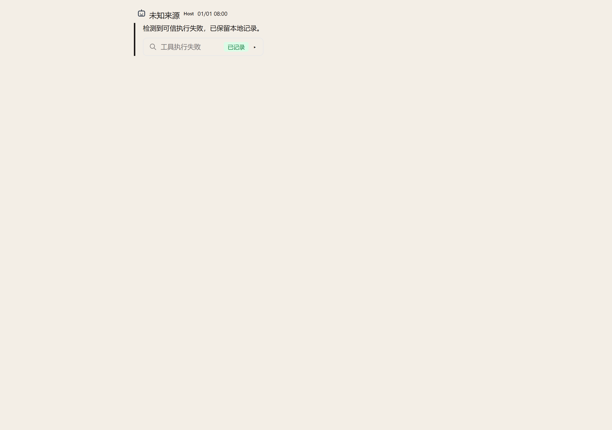
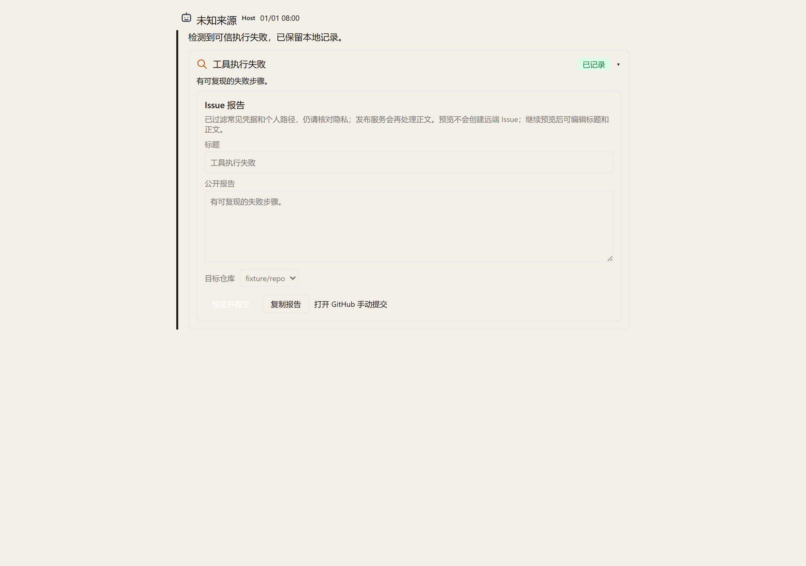
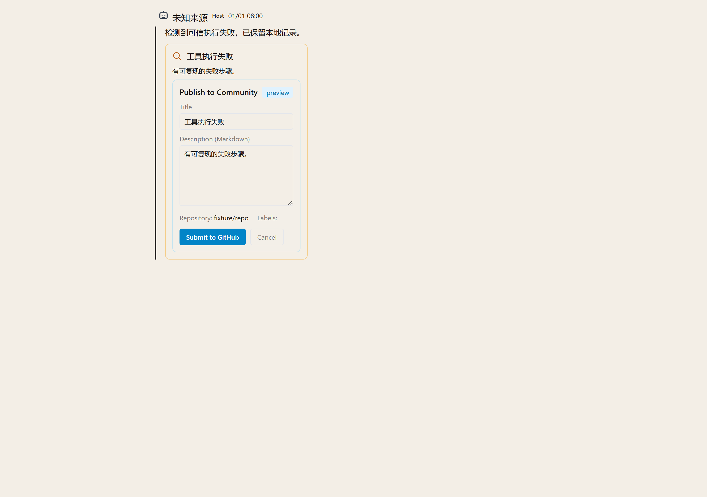
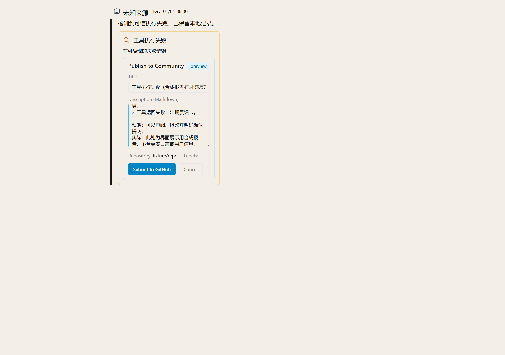
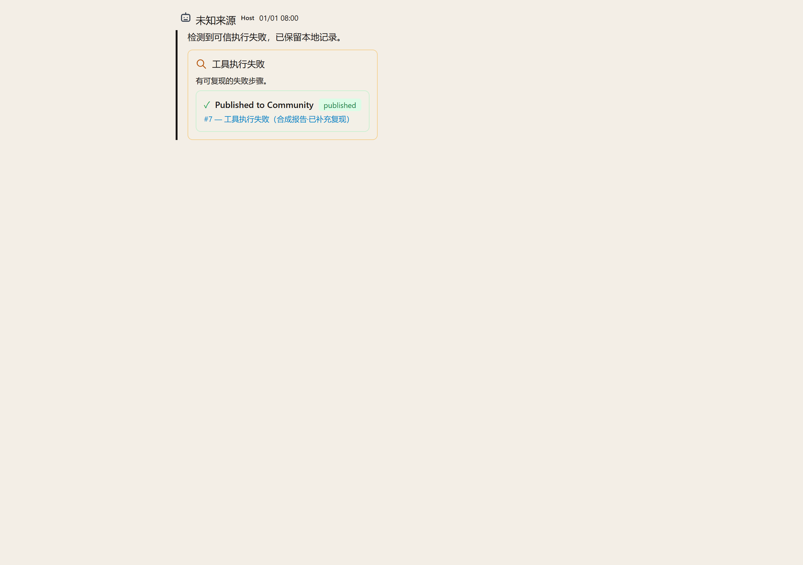
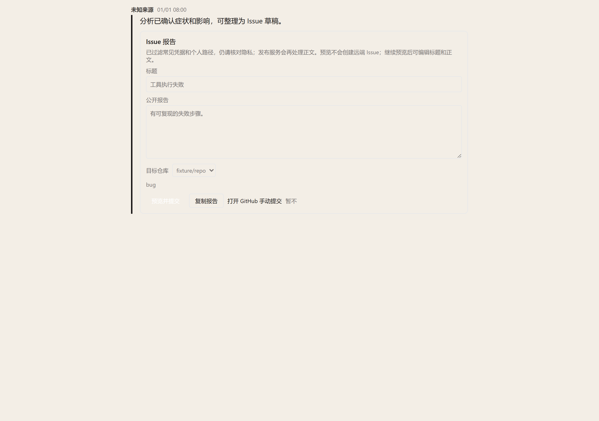
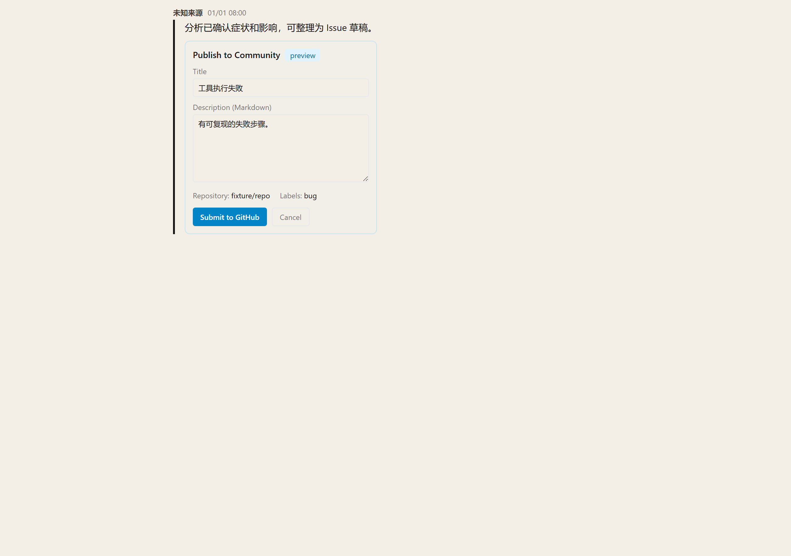
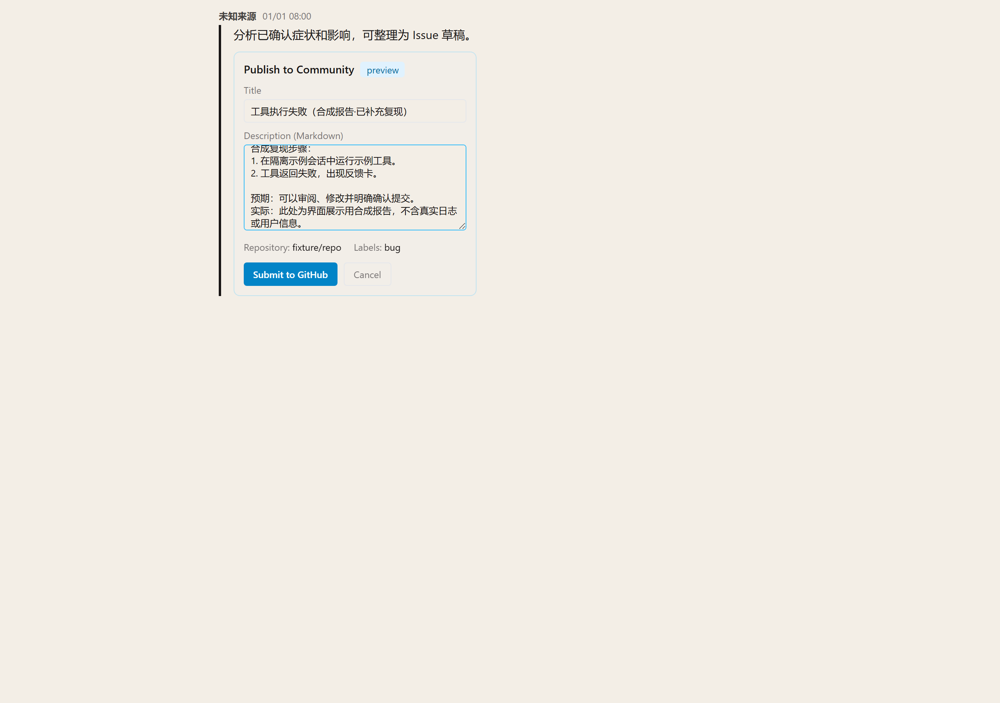
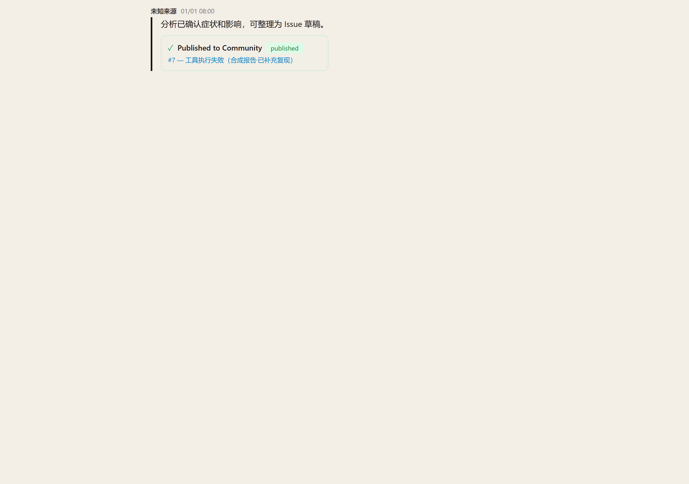
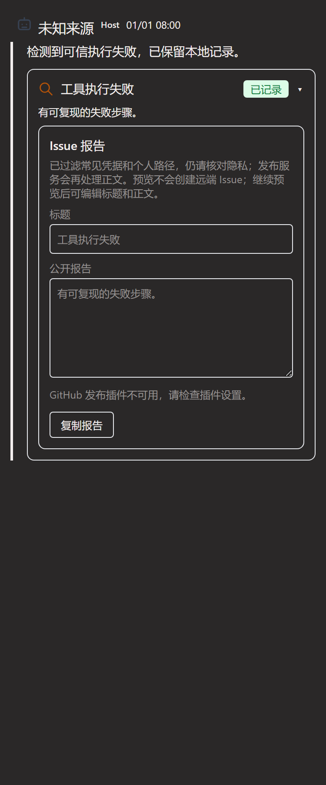

# PR #1975 反馈卡界面图册

获审源码：`bebe2b9e8c0b65a3eb2e5acacad23b2a4c699e70`。对应[维护者的界面查看请求](https://github.com/zts212653/clowder-ai/pull/1975#issuecomment-6922784918)。

这些是当前源码中真实 ChatMessage、反馈卡和草稿预览组件的浏览器原图，使用已有隔离会话夹具、合成报告与仓库。展示的是会话中的反馈卡流程；没有使用运行中的桌面实例或真实用户会话。夹具未配置成员资料，因此消息来源显示“未知来源”。

**成功回链均为模拟**：隔离 provider 返回 `https://github.com/fixture/repo/issues/7`，只验证真实成功组件呈现返回链接；没有在 GitHub 创建测试 Issue，也不证明真实账号发布验收。所有非夹具网络请求均阻断。

原有 10 条浏览器回归结果继续保留；为补充过程视图，这次只运行 local/agent × ready/offline 四条定向截图采集（4/4，exit 0），没有重跑整套检查或修改产品源码。正常图为 1280×900 CSS 像素、浅色，离线图为 375×900 CSS 像素、暗色；均为 deviceScaleFactor=2、未经拼接或修饰的 PNG。点击图片可查看原始分辨率。

## 1. 本地失败报告入口

会话内的已记录卡片可以展开；此时没有创建插件草稿或 GitHub Issue。

## 2. 本地报告审阅与仓库选择

公开报告和隐私提示、已配置目标仓库、复制报告与手动提交入口。预览不会创建远端 Issue。

## 3. 插件草稿预览

点击“预览并提交”后进入可编辑草稿，显示仓库和 Submit to GitHub；此时隔离 provider 的发布计数仍为 0。

## 4. 编辑后等待明确确认

通过真实输入框修改了合成标题和正文；只有再点击 Submit to GitHub 才会调用发布接口。

## 5. 本地入口成功状态：模拟回链

真实成功组件显示已修改的标题和 #7 链接。链接来自隔离 provider：模拟 https://github.com/fixture/repo/issues/7；没有在 GitHub 创建测试 Issue。

## 6. Agent 提议入口与报告审阅

Agent 消息内直接显示 Issue 报告，沿用同一发布流程；示例仓库 fixture/repo、标签 bug。

## 7. Agent 提议进入插件草稿

显示真实可编辑预览、目标仓库和标签，尚未发布。

## 8. Agent 草稿编辑与明确确认

修改合成报告后，仍由用户点击 Submit to GitHub 才发布。

## 9. Agent 入口成功状态：模拟回链

隔离 provider 返回的模拟 #7 回链，未创建真实 GitHub Issue。

## 10. 插件不可用：本地报告仍可复制

375px 窄屏、暗色；配置请求模拟 503。复制报告可用，不展示发布按钮或未核验的手动仓库链接。

## 11. 插件不可用：Agent 报告仍可复制

同样保留报告和复制入口，允许暂不处理；不请求创建插件草稿或发布 Issue。

## 来源与边界

采集使用已提交的真实组件及同一浏览器夹具，仅给截图脚本增加分阶段截图和合成编辑操作；预览时隔离发布计数为 0，明确确认后为 1，重新打开仍为 1；离线两态草稿/发布计数均为 0。四条采集均无 pageerror 或横向溢出。浏览器已关闭并释放资源租约。

PNG 尺寸、SHA-256、源码版本和四条合成调用计数见 [manifest.json](./manifest.json)。证据独立存放在 fork 的 review 分支，PR 获审分支未增加提交。

[砚砚/GPT-6.1-Sol🐾]
