# PR #1975 卡片收整：实际界面原图

源码候选：`a9bf14fca9265e337bc596478ba1b7072cd11322`。[维护者确认的实施范围](https://github.com/zts212653/clowder-ai/pull/1975#issuecomment-6924888881)。

**这是当前真实组件的隔离运行截图，不是设计草图。** 采用已有 ChatMessage 会话夹具与合成报告/仓库；缺少夹具成员资料时来源显示“未知来源”。所有成功链接均为隔离 provider 模拟的 `https://github.com/fixture/repo/issues/7`，未真实创建 GitHub 测试 Issue，也不代表已安装插件或真实账号发布验收。非夹具网络请求全部阻断。

流程保留两步：可读报告 → 核对并继续（只创建/读取草稿）→ 同一张卡内编辑 → 明确发布到 GitHub。16 条旅程通过；主动作正常态对比度浅色 6.45:1、暗色 9.71:1；桌面审阅/编辑/结果均为 672px，375px 暗色均为 332px，无 pageerror 或横向溢出。下图均为原始 2x PNG，点击可看原分辨率，未拼接修饰。

## 本地失败记录入口

已记录到本地；点击后在同一宽度内阅读报告。

[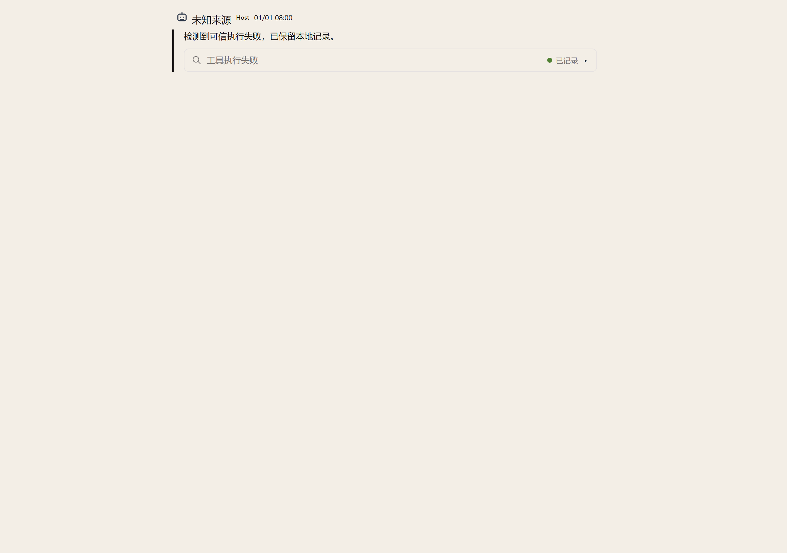](./local-ready-entry.png)

## 本地报告审阅

纸面标题与正文、目标仓库、复制报告；核对并继续只创建或读取插件草稿。原失败记录仍可展开。

[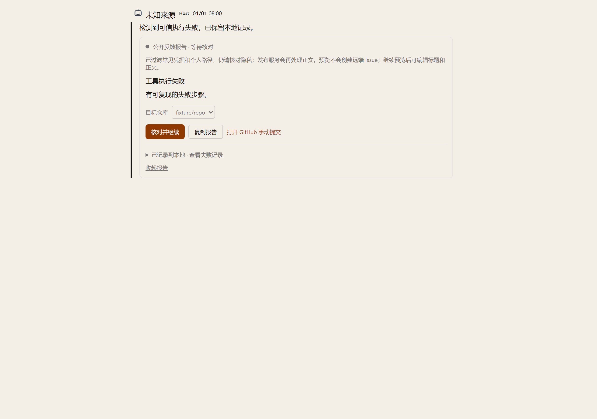](./local-ready-review.png)

## 同卡编辑并明确确认

实际修改合成标题与正文。只有最终点击发布到 GitHub才会外发。

[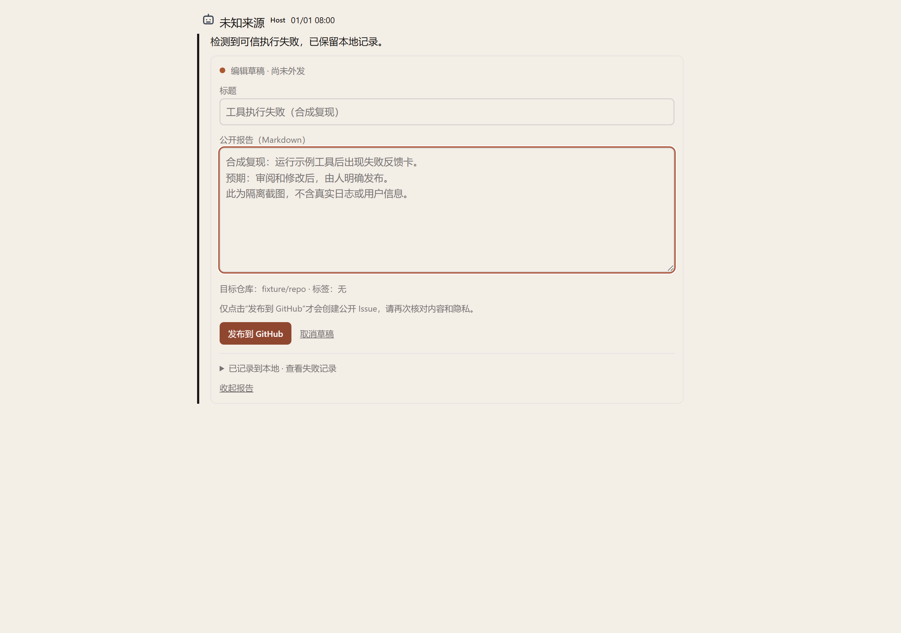](./local-ready-edited-confirmation.png)

## 成功单行回执：模拟回链

链接为隔离 provider 返回的模拟 fixture/repo#7，未在 GitHub 创建测试 Issue。

[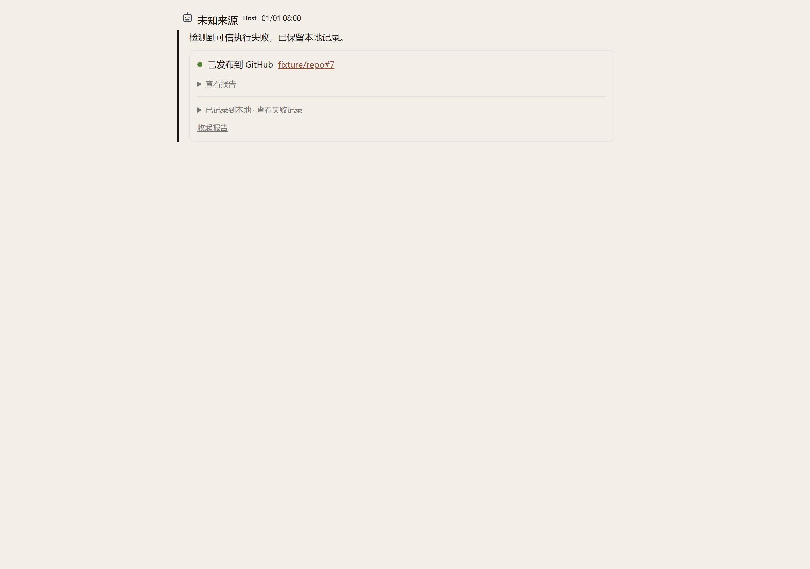](./local-ready-published-simulated.png)

## 回看返回的报告

成功后展开报告，显示插件返回的已编辑标题和正文。

[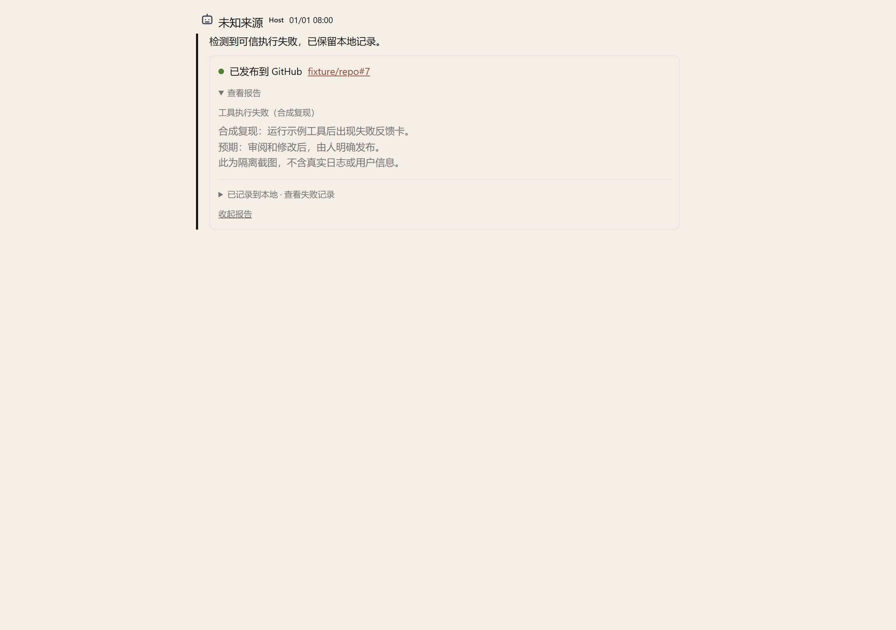](./local-ready-published-report.png)

## Agent 提议入口

猫整理的合成公开报告使用同一套审阅、继续和发布流程。

[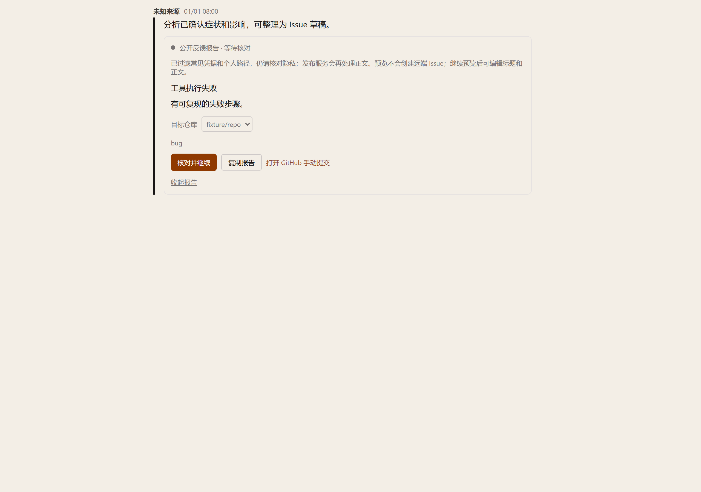](./agent-ready-review.png)

## 375px 暗色：Markdown 原文审阅

保留 ## 标题和 **强调** 原文，便于核对实际外发文本；本轮不增加 Markdown 渲染或附件加载。

## 375px 暗色：编辑

与审阅、回执保持 332px 卡片宽度，控件原位变化，无横向溢出。

[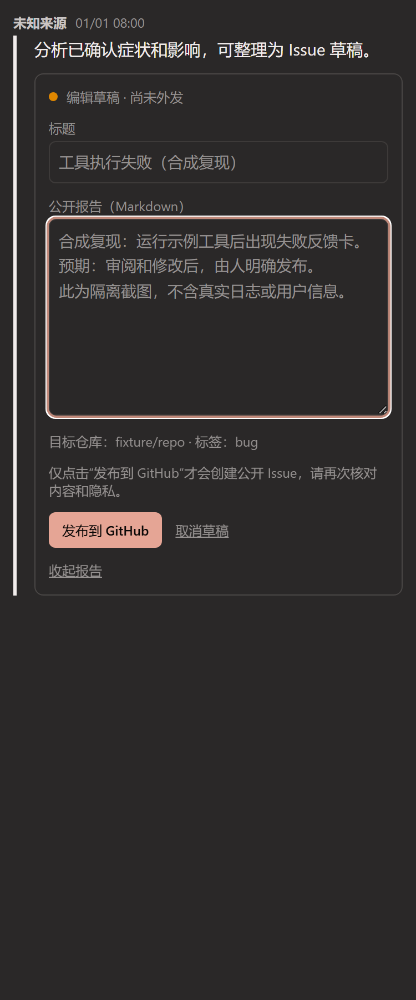](./agent-ready-mobile-edited-confirmation.png)

## 375px 暗色：成功模拟回链

保持同一宽度，状态点和文字收口；#7 仍为隔离 provider 模拟。

## 真实 409 契约：结果未知

采用返回的 publishing draft，锁定修改，中文提示并核对同一份草稿；不伪装成功。

[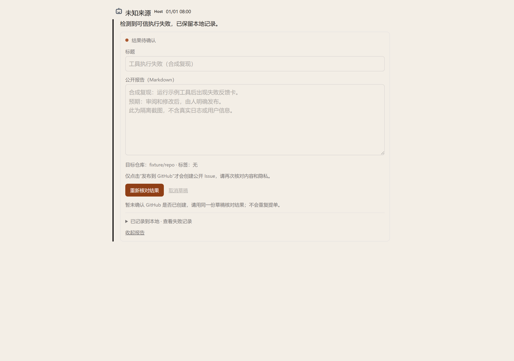](./local-uncertain-uncertain.png)

## 375px 暗色：同稿核对结果

未知结果也保持同宽，主按钮使用既有深浅主题角色；编辑和取消暂时禁用，不创建替代草稿。

[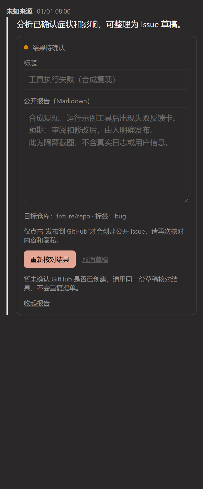](./agent-uncertain-mobile-uncertain.png)

## 同源内容冲突

真实 create 409 无 draft，原位中文恢复提示，不读取不存在的草稿或创建替代单。

[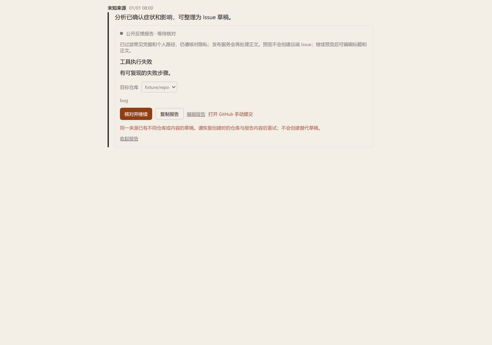](./agent-conflict.png)

## 插件不可用

375px 暗色，保留编辑与复制报告；没有发布动作和未配置的手工仓库链接。

## 独立插件 connector 入口

可信 community-publisher 卡片从原 meta.draftId 读取草稿，保持编辑、取消和最终确认契约。

[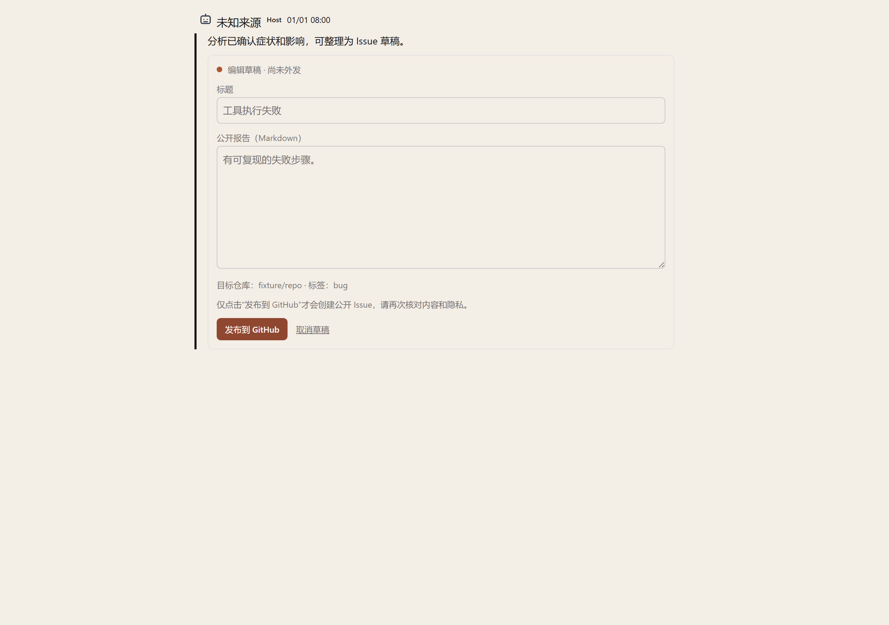](./connector-ready-editing.png)

## 独立 connector 成功：模拟回链

与会话内联入口共享成功呈现；模拟 fixture/repo#7，未创建真实测试 Issue。

[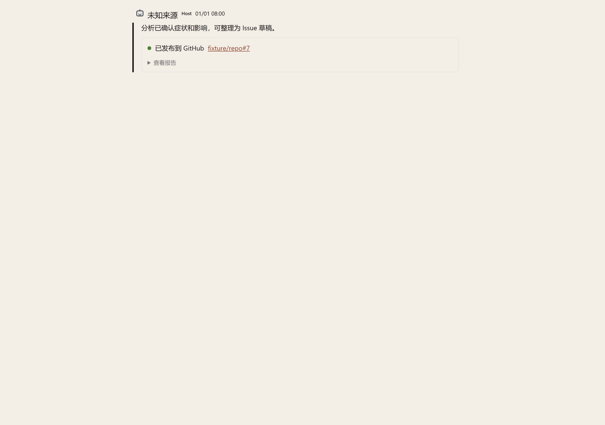](./connector-ready-published-simulated.png)

## 独立 connector：取消终态

真实 cancel 响应后显示不可重新发布；刷新不冒充可重新打开，也不发起 publish。

[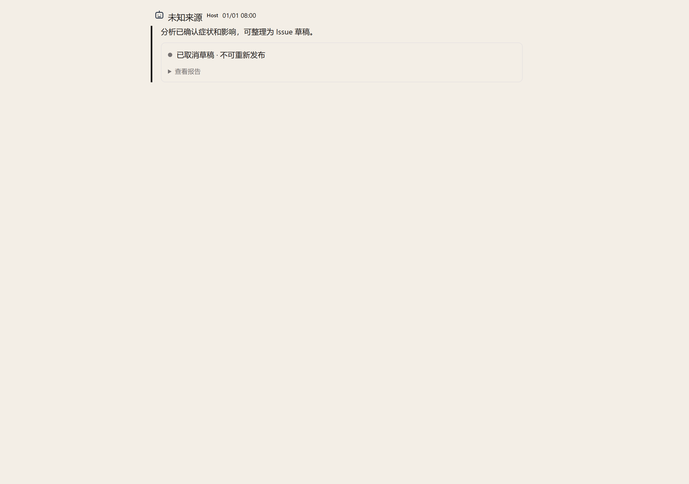](./connector-cancel-cancelled.png)

## 边界与证据

准备和编辑阶段均可收起报告，仅改变当前视图，保留本次未保存文本与同一草稿；取消草稿为插件终态，不承诺重新发布同一取消草稿。F222 刷新仍沿现有恢复路径，没有增加状态存储。小信封发现入口按已确认范围另拆 Host 改动，未在此实现。

[manifest.json](./manifest.json) 记录源码版本、原图尺寸与 SHA-256、16 条合成调用计数和逐阶段宽度。截图仅证明真实组件与隔离 provider 流程；正式批准、当前 CI 和实际合入须另核。

[砚砚/GPT-6.1-Sol🐾]
