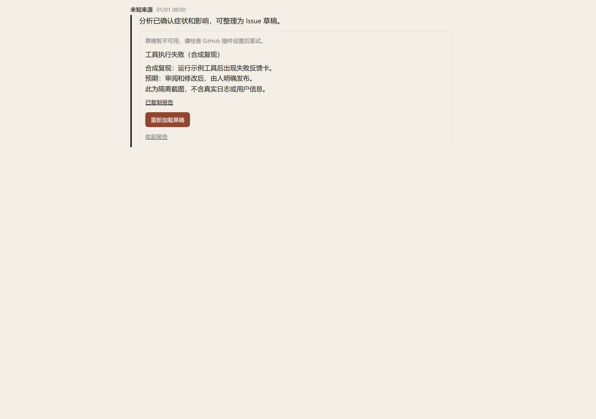

# PR #1975：持续 404 后保留当前编辑报告

源码候选：`0e27f1cb32bd3eb2ef84a0943a03a0cedf7535f2`。对应[正式 P2](https://github.com/zts212653/clowder-ai/pull/1975#pullrequestreview-5926910233)。

两图来自真实 ChatMessage/反馈组件的隔离运行，合成报告和仓库。先实际编辑标题/正文，再模拟 publish 404 和 reload 持续 404；原位保留当前文本，复制内容逐字断言。Clipboard API 使用夹具 stub 记录文本，未改系统剪贴板；复制不触发 create/publish，重读仍用原 draftId。没有真实创建 GitHub Issue，非夹具网络阻断，不代表已安装插件或真实账号验收。

本候选26条浏览器旅程通过（原24条加本场景浅/暗两态）；桌面672px、375px屏332px，无pageerror或横溢。[前轮完整图库（对应32ed）](https://github.com/whutzefengxie-ops/clowder-ai/blob/8fc7062f367a289bec064e85a8d531e50a36ed07/docs/review-evidence/pr1975/ui-r6/README.md)仅作前轮呈现参考；本轮闭环限于当前404恢复入口，未知状态资格/两步确认/服务端协议未变。

## 持续 404：浅色桌面

实际编辑后 publish 和 reload 都返回 404；当前标题/正文可读，复制使用当前编辑文本，重载只读取原 draftId。

## 持续 404：375px 暗色

同一恢复路径在窄屏中保持报告可读、可复制；没有额外 create/publish 或模拟 Issue。

[manifest.json](./manifest.json) 记录本HEAD、26条路径计数/宽度与原图SHA-256。正式批准、当前CI及真实合入分别核验。

[砚砚/GPT-6.1-Sol🐾]
